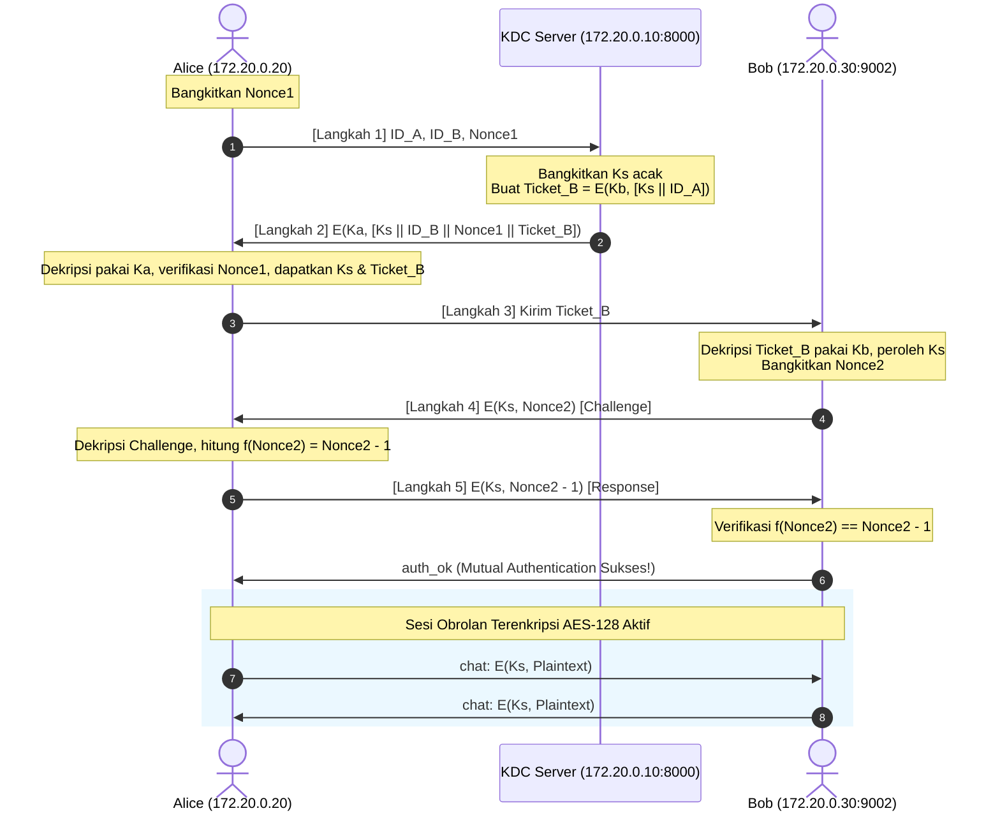

# Key Distribution Problem: Key Distribution Center (KDC) & Protokol Needham-Schroeder Berbasis AES-128 Manual

Proyek ini mendemonstrasikan penyelesaian **Key Distribution Problem** (masalah distribusi kunci rahasia simetris) menggunakan arsitektur tersentralisasi **Key Distribution Center (KDC)** dengan protokol klasik **Needham-Schroeder Symmetric Key Protocol**. Seluruh enkripsi dan dekripsi menggunakan implementasi manual **AES-128** (*pure Python from scratch*) tanpa pustaka kriptografi eksternal.

Proyek ini dilengkapi dengan lingkungan virtual multi-node terisolasi berbasis **Docker Compose** (`ki_kdc`, `ki_alice`, `ki_bob`), fitur otentikasi timbal-balik (*mutual authentication*), perlindungan terhadap serangan pemutaran ulang (*replay attack*), obrolan dua arah terenkripsi (*bidirectional AES-128 chat*), serta mekanisme *dynamic rekeying* secara *real-time*.

---

## 📌 Daftar Isi
1. [Latar Belakang & Konsep Masalah](#-latar-belakang--konsep-masalah)
2. [Arsitektur & Protokol Needham-Schroeder](#-arsitektur--protokol-needham-schroeder)
   - [Entitas Terlibat](#entitas-terlibat)
   - [Langkah-Langkah Protokol (Handshake 5 Tahap)](#langkah-langkah-protokol-handshake-5-tahap)
   - [Diagram Alur Protokol](#diagram-alur-protokol)
3. [Implementasi Manual AES-128 (`aes.py`)](#-implementasi-manual-aes-128-aespy)
4. [Fitur-Fitur Sistem](#-fitur-fitur-sistem)
   - [Otentikasi Dua Arah & Anti-Replay](#otentikasi-dua-arah--anti-replay)
   - [Obrolan Terenkripsi Real-Time](#obrolan-terenkripsi-real-time)
   - [Dynamic Rekeying (`/rekey`)](#dynamic-rekeying-rekey)
   - [Pengubahan Kunci Manual (`/setkey`)](#pengubahan-kunci-manual-setkey)
5. [Struktur Berkas Proyek](#-struktur-berkas-proyek)
6. [Panduan Menjalankan Sistem](#-panduan-menjalankan-sistem)
   - [Metode 1: Menggunakan Docker Compose (Direkomendasikan)](#metode-1-menggunakan-docker-compose-direkomendasikan)
   - [Metode 2: Menjalankan Langsung di Host Lokal (Tanpa Docker)](#metode-2-menjalankan-langsung-di-host-lokal-tanpa-docker)
7. [Daftar Perintah Obrolan](#-daftar-perintah-obrolan)
8. [Analisis Keamanan](#-analisis-keamanan)

---

## 💡 Latar Belakang & Konsep Masalah

Dalam kriptografi simetris, dua pihak yang ingin berkomunikasi secara rahasia harus memiliki kunci yang sama (*shared secret key*). Namun, jika terdapat $N$ entitas dalam jaringan yang ingin saling berkomunikasi secara berpasangan, diperlukan sebanyak:

$$\frac{N(N - 1)}{2}$$

pasang kunci rahasia. Skema ini tidak praktis (*unscalable*) dan memunculkan masalah besar dalam pertukaran kunci awal secara aman melalui kanal publik (*Key Distribution Problem*).

**Solusi KDC**:
Dengan memperkenalkan pihak ketiga tepercaya (*Trusted Third Party / TTP*) yang disebut **Key Distribution Center (KDC)**, setiap node hanya perlu menyimpan **1 Master Key** yang dibagi khusus dengan KDC. Jumlah kunci dalam sistem menyusut drastis menjadi hanya $N$ kunci master. Ketika dua entitas ingin berkomunikasi, KDC akan menerbitkan **Session Key ($K_S$)** sementara yang unik dan terenkripsi untuk sesi tersebut.

---

## 🛡️ Arsitektur & Protokol Needham-Schroeder

### Entitas Terlibat
| Entitas | Nama Host / IP Container | Peran | Kunci yang Dimiliki |
|---|---|---|---|
| **KDC** | `172.20.0.10` (Port 8000) | Server Pusat Distribusi Kunci | $K_A$ (Master Alice), $K_B$ (Master Bob) |
| **Alice** | `172.20.0.20` | Inisiator Komunikasi (Client) | $K_A$ (Master), $K_S$ (Session Key dari KDC) |
| **Bob** | `172.20.0.30` (Port 9002) | Responder Komunikasi (Server/Peer) | $K_B$ (Master), $K_S$ (Session Key via Ticket B) |

### Langkah-Langkah Protokol (Handshake 5 Tahap)

1. **Langkah 1 ($A \to KDC$)**:  
   Alice mengirimkan permintaan ke KDC:
   $$\text{Req} = [ID_A, ID_B, Nonce_1]$$
   di mana $Nonce_1$ adalah bilangan acak sekali pakai (*number used once*) untuk mencegah serangan pemutaran ulang (*replay attack*).

2. **Langkah 2 ($KDC \to A$)**:  
   KDC menghasilkan Session Key acak $K_S$. KDC membuat tiket untuk Bob:
   $$Ticket_B = E(K_B, [K_S \parallel ID_A])$$
   dan membungkus respons lengkap untuk Alice menggunakan master key $K_A$:
   $$\text{Resp}_A = E(K_A, [K_S \parallel ID_B \parallel Nonce_1 \parallel Ticket_B])$$
   Alice mendekripsi respons ini dengan $K_A$, memverifikasi bahwa $Nonce_1$ cocok, lalu mengekstrak $K_S$ dan $Ticket_B$.

3. **Langkah 3 ($A \to B$)**:  
   Alice menghubungkan diri ke Bob dan menyerahkan tiket milik Bob:
   $$\text{Msg}_3 = Ticket_B$$
   Bob mendekripsi $Ticket_B$ menggunakan kunci masternya ($K_B$) dan mendapatkan $K_S$ serta identitas $ID_A$.

4. **Langkah 4 ($B \to A$)**:  
   Bob ingin memastikan bahwa pihak yang terhubung benar-benar memegang $K_S$ yang valid (*challenge*). Bob membangkitkan bilangan acak $Nonce_2$ dan mengirimkannya dalam keadaan terenkripsi dengan $K_S$:
   $$\text{Challenge} = E(K_S, Nonce_2)$$

5. **Langkah 5 ($A \to B$)**:  
   Alice mendekripsi pesan Bob untuk mendapatkan $Nonce_2$, melakukan fungsi transformasi $f(Nonce_2) = Nonce_2 - 1$, lalu mengenkripsi kembali hasilnya dengan $K_S$:
   $$\text{Response} = E(K_S, Nonce_2 - 1)$$
   Bob memverifikasi apakah respons bernilai tepat $Nonce_2 - 1$. Jika valid, Bob membalas dengan status `auth_ok`. Otentikasi dua arah (*mutual authentication*) selesai dan kanal obrolan aman resmi dibuka.

### Diagram Alur Protokol



---

## 🔐 Implementasi Manual AES-128 (`aes.py`)

Cipher yang digunakan dalam modul ini adalah **AES-128 (Advanced Encryption Standard)** yang ditulis dari nol tanpa modul kriptografi bawaan:

- **Representasi State Matrix**: Blok data 16-byte diatur dalam matriks $4 \times 4$.
- **Transformasi Standar AES**:
  - `SubBytes` & `InvSubBytes`: Substitusi non-linear menggunakan tabel S-Box standar dan Inverse S-Box yang dibangkitkan secara matematis.
  - `ShiftRows` & `InvShiftRows`: Pergeseran sirkular byte pada tiap baris matriks status.
  - `MixColumns` & `InvMixColumns`: Perkalian polinomial modulo $x^4 + 1$ di medan hingga Galois Field $GF(2^8)$ menggunakan fungsi reduksi `xtime`.
  - `AddRoundKey`: Operasi XOR bit demi bit antara matriks status dan *round key*.
- **Key Expansion**: Pembangkitan 11 putaran kunci (10 ronde AES + ronde inisial) dari kunci 128-bit menggunakan konstanta putaran `RCON`, `RotWord`, dan substitusi `SubWord`.
- **Mode & Padding**: Mode Electronic Codebook (ECB) per blok dengan padding **PKCS#7** untuk menjamin ukuran data selalu kelipatan 16 byte.
- **Normalisasi Kunci**: Kunci string otomatis disesuaikan menjadi 16-byte melalui fungsi `normalize_key`.

---

## ✨ Fitur-Fitur Sistem

### Otentikasi Dua Arah & Anti-Replay
- Alice memvalidasi integritas pesan KDC menggunakan $Nonce_1$ miliknya.
- Bob memvalidasi kepemilikan kunci sesi oleh Alice melalui tantangan numerik $Nonce_2 \to Nonce_2 - 1$.
- Mencegah serangan *replay attack* karena nonce berubah di setiap sesi baru.

### Obrolan Terenkripsi Real-Time
- Menggunakan arsitektur multi-thread untuk membaca dan mengirim pesan secara simultan (*full-duplex*).
- Setiap transmisi pesan menampilkan ciphertext heksadesimal mentah di terminal pengirim dan penerima, sebelum didekripsi menjadi teks asli.

### Dynamic Rekeying (`/rekey`)
- Pengguna Alice dapat mengetikkan perintah `/rekey` kapan saja saat obrolan berlangsung.
- Alice akan secara otomatis menghubungi KDC, meminta Session Key ($K_S$) baru dan $Ticket_B$ baru, lalu melakukan negosiasi ulang 3 langkah (`rekey_step3`, `rekey_step4`, `rekey_step5`) dengan Bob secara mulus tanpa memutus koneksi socket yang sedang berjalan.

### Pengubahan Kunci Manual (`/setkey`)
- Perintah `/setkey <kunci_baru>` memungkinkan pengujian manual perubahan kunci sesi secara sinkron antara kedua pihak.

---

## 📁 Struktur Berkas Proyek

```text
Key Distribution Problem/
├── aes.py                 # Modul kriptografi AES-128 murni (KeyExpansion, S-Box, Encrypt, Decrypt)
├── kdc.py                 # Server Key Distribution Center (manajemen Ka, Kb, dan penerbitan Ks/Ticket)
├── alice.py               # Node Alice (inisiator, request KDC, handshake Bob, chat client)
├── bob.py                 # Node Bob (responder, verifikasi Ticket B, challenge-response, chat peer)
├── Dockerfile             # Konfigurasi container image Python 3.11-slim
└── docker-compose.yml     # Konfigurasi network terisolasi (ki_net: 172.20.0.0/16) dan 3 service
```

---

## 🚀 Panduan Menjalankan Sistem

### Metode 1: Menggunakan Docker Compose (Direkomendasikan)

Metode ini mensimulasikan lingkungan jaringan nyata dengan subnet `172.20.0.0/16`, di mana masing-masing entitas berjalan di container terpisah.

#### 1. Bangun dan Jalankan Container
Buka terminal di dalam direktori `Key Distribution Problem`:
```powershell
docker compose up -d --build
```
Periksa apakah ketiga container sudah aktif:
```powershell
docker compose ps
```
*(Container `ki_kdc`, `ki_bob`, dan `ki_alice` harus berstatus `Up`)*.

#### 2. Jalankan KDC Server
Buka **Terminal 1**:
```powershell
docker exec -it ki_kdc python kdc.py
```
*Tekan `Enter` untuk seluruh isian (Port default: 8000, Ka: MasterAliceKey12, Kb: MasterBobKey1234).*

#### 3. Jalankan Node Bob
Buka **Terminal 2**:
```powershell
docker exec -it ki_bob python bob.py
```
*Tekan `Enter` untuk seluruh isian (Port default: 9002, Kb: MasterBobKey1234).*

#### 4. Jalankan Node Alice
Buka **Terminal 3**:
```powershell
docker exec -it ki_alice python alice.py
```
*Tekan `Enter` untuk seluruh isian (IP KDC: 172.20.0.10, Port: 8000, IP Bob: 172.20.0.30, Port: 9002, Ka: MasterAliceKey12).*

Alice akan segera menghubungi KDC, melakukan handshake ke Bob, dan kedua pihak akan masuk ke sesi chat terenkripsi!

#### 5. Mematikan Container Setelah Selesai
```powershell
docker compose down
```

---

### Metode 2: Menjalankan Langsung di Host Lokal (Tanpa Docker)

Jika Anda tidak memasang Docker, Anda dapat menjalankannya langsung di mesin lokal menggunakan tiga jendela terminal terpisah:

#### 1. Jalankan KDC di Terminal 1:
```powershell
python kdc.py
```
*(Tekan `Enter` untuk nilai default)*

#### 2. Jalankan Bob di Terminal 2:
```powershell
python bob.py
```
*(Tekan `Enter` untuk nilai default)*

#### 3. Jalankan Alice di Terminal 3:
```powershell
python alice.py
```
Saat diminta IP:
- **IP KDC**: Masukkan `127.0.0.1` (tekan enter untuk port 8000)
- **IP Bob**: Masukkan `127.0.0.1` (tekan enter untuk port 9002)
- **Master Key Ka**: Tekan `Enter` (default: `MasterAliceKey12`)

---

## 💬 Daftar Perintah Obrolan

Selama sesi obrolan antara Alice dan Bob aktif, perintah berikut dapat digunakan:

| Perintah | Node yang Mendukung | Deskripsi |
|---|---|---|
| `<teks>` | Alice & Bob | Mengirimkan pesan chat biasa yang terenkripsi AES-128 |
| `/rekey` | Alice | Menghubungi KDC untuk memperbarui Session Key ($K_S$) secara otomatis |
| `/setkey <kunci_baru>` | Alice & Bob | Mengubah kunci sesi aktif secara manual pada kedua node |
| `/exit` | Alice & Bob | Menutup koneksi obrolan dan keluar dari program |

---

## 🔒 Analisis Keamanan

1. **Kerahasiaan Kunci Master**:
   - Master Key $K_A$ tidak pernah dikirim ke Bob atau pihak luar manapun; hanya diketahui oleh Alice dan KDC.
   - Master Key $K_B$ hanya diketahui oleh Bob dan KDC.
2. **Kerahasiaan Kunci Sesi ($K_S$)**:
   - $K_S$ dikirim ke Alice terenkripsi dengan $K_A$, dan dikirim ke Bob terenkripsi di dalam $Ticket_B$ menggunakan $K_B$. Penyadap di jalur komunikasi (*eavesdropper*) tidak dapat membaca $K_S$.
3. **Pencegahan Replay Attack**:
   - Penggunaan $Nonce_1$ memastikan bahwa tiket lama yang direkam penyerang tidak dapat disodorkan kembali ke Alice.
   - Tantangan $Nonce_2 \to Nonce_2 - 1$ membuktikan bahwa Alice aktif secara *real-time* dan benar-benar memiliki $K_S$.
