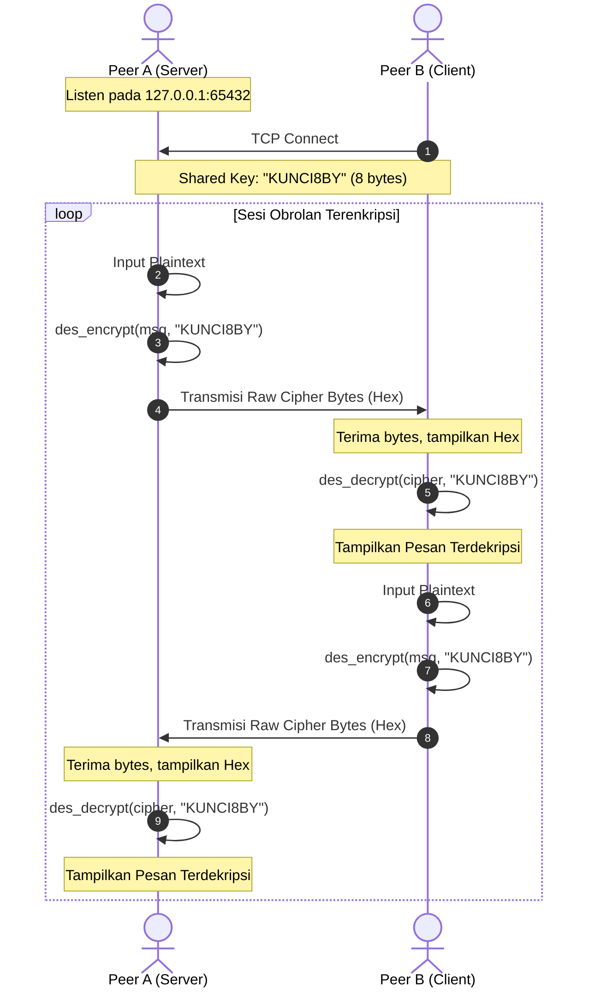

# Kriptografi Simetris Klasik: Data Encryption Standard (DES) Manual & Peer-to-Peer Secure Chat

Modul ini mengimplementasikan algoritma enkripsi simetris **Data Encryption Standard (DES)** secara manual (*pure Python from scratch*) tanpa menggunakan pustaka kriptografi pihak ketiga (seperti `pycryptodome` atau `cryptography`). Selain inti algoritma DES, modul ini juga dilengkapi dengan aplikasi obrolan terenkripsi *Peer-to-Peer* (P2P) berbasis TCP socket multi-thread (`peer_a.py` dan `peer_b.py`).

---

## 📌 Daftar Isi
1. [Fitur Utama](#-fitur-utama)
2. [Prinsip & Mekanisme Algoritma DES](#-prinsip--mekanisme-algoritma-des)
   - [Struktur Jaringan Feistel](#struktur-jaringan-feistel)
   - [Key Schedule (Pembangkitan Subkunci)](#key-schedule-pembangkitan-subkunci)
   - [Fungsi Putaran Feistel (F-Function)](#fungsi-putaran-feistel-f-function)
   - [Padding PKCS#7](#padding-pkcs7)
3. [Arsitektur Chat Peer-to-Peer](#-arsitektur-chat-peer-to-peer)
4. [Struktur Berkas](#-struktur-berkas)
5. [Panduan Instalasi & Penggunaan](#-panduan-instalasi--penggunaan)
   - [Prasyarat](#prasyarat)
   - [Langkah Eksekusi P2P Chat](#langkah-eksekusi-p2p-chat)
   - [Contoh Interaksi](#contoh-interaksi)
6. [Analisis Keamanan](#-analisis-keamanan)

---

## 🚀 Fitur Utama

- **100% Pure Python**: Tidak memerlukan dependensi eksternal, hanya menggunakan modul bawaan Python (`socket`, `threading`).
- **Implementasi DES Lengkap**:
  - Tabel permutasi standar: Initial Permutation (IP), Final Permutation (FP/$IP^{-1}$), Expansion Permutation (E), dan Permutasi P-Box.
  - 8 buah S-Box (*Substitution Box*) lengkap berstandar NIST/FIPS 46-3.
  - Pembangkitan 16 subkunci (*subkeys*) 48-bit melalui tabel PC-1, PC-2, dan *circular left shift*.
  - 16 putaran Feistel Cipher untuk enkripsi dan dekripsi.
- **Padding PKCS#7**: Penanganan otomatis plaintext berukuran sembarang agar pas dengan kelipatan ukuran blok DES (64-bit / 8-byte).
- **Socket TCP Dua Arah (Duplex)**: Chat real-time antara Peer A (server/listener) dan Peer B (client) dengan penerimaan pesan di latar belakang (*background thread*).
- **Inspeksi Ciphertext**: Ciphertext ditampilkan dalam format heksadesimal mentah sebelum didekripsi oleh pihak penerima.

---

## 🧠 Prinsip & Mekanisme Algoritma DES

DES adalah algoritma *symmetric block cipher* yang memproses blok data sebesar **64 bit** (8 byte) dengan panjang kunci efektif sebesar **56 bit** (dari total 64 bit kunci, 8 bit merupakan bit paritas).

### Struktur Jaringan Feistel
Proses enkripsi DES didasarkan pada jaringan Feistel 16 putaran:
1. **Initial Permutation (IP)**: Blok 64-bit plaintext diacak urutan bitnya sesuai tabel IP, kemudian dibagi menjadi dua paruh: $L_0$ (32 bit kiri) dan $R_0$ (32 bit kanan).
2. **16 Feistel Rounds**: Untuk putaran $i = 1, \dots, 16$:
   $$L_i = R_{i-1}$$
   $$R_i = L_{i-1} \oplus f(R_{i-1}, K_i)$$
   di mana $K_i$ adalah subkunci 48-bit untuk putaran ke-$i$.
3. **Swap & Final Permutation (FP)**: Pada akhir putaran ke-16, paruh dibalik menjadi $(R_{16} \parallel L_{16})$, lalu dilakukan permutasi invers $FP = IP^{-1}$ untuk menghasilkan ciphertext 64-bit.
4. **Dekripsi**: Proses dekripsi identik dengan enkripsi, hanya saja urutan subkunci dibalik ($K_{16}, K_{15}, \dots, K_1$).

```
           Plaintext (64-bit)
                  │
        [Initial Permutation (IP)]
                  │
        ┌─────────┴─────────┐
     L0 (32-bit)         R0 (32-bit)
        │                   │──────┐
        │                   │      ▼
        │                 ┌─── [ f(R, K1) ] ◄── Subkey K1 (48-bit)
        ▼                 │        │
      ( X ) ◄─────────────┘        │
        │                          │
     R0 ───┐                    ┌──┘
           ▼                    ▼
        L1 (32-bit)          R1 (32-bit)
        │                   │
                ... (16 Rounds) ...
        │                   │
        L16 (32-bit)        R16 (32-bit)
           \               /
            \             /   (Pre-Output Swap)
             \           /
        ┌─────┴─────────┴─────┐
        │  R16 (32) │ L16 (32) │
        └──────────┬──────────┘
                   ▼
        [Final Permutation (FP)]
                   │
           Ciphertext (64-bit)
```

### Key Schedule (Pembangkitan Subkunci)
1. Kunci string 8 karakter diubah menjadi 64-bit biner.
2. Bit paritas dibuang melalui **PC-1** (*Permuted Choice 1*), menghasilkan 56 bit yang dibagi menjadi $C_0$ (28 bit) dan $D_0$ (28 bit).
3. Untuk setiap putaran ke-$i$, $C_{i-1}$ dan $D_{i-1}$ digeser ke kiri secara melingkar (*left circular shift*) sebanyak 1 bit (putaran 1, 2, 9, 16) atau 2 bit (putaran lainnya).
4. Hasil penggabungan $C_i$ dan $D_i$ (56 bit) dikompresi menjadi subkunci 48-bit $K_i$ menggunakan **PC-2** (*Permuted Choice 2*).

### Fungsi Putaran Feistel ($f$-Function)
Fungsi $f(R, K)$ menerima input $R$ (32-bit) dan subkunci $K$ (48-bit):
1. **Expansion (E)**: $R$ diekspansi dari 32 bit menjadi 48 bit.
2. **Key Mixing**: Hasil ekspansi di-XOR dengan subkunci $K$: $E(R) \oplus K$.
3. **Substitution Boxes (S-Boxes)**: 48 bit dipecah menjadi 8 kelompok 6-bit. Masing-masing kelompok masuk ke salah satu dari 8 kotak substitusi ($S_1 - S_8$):
   - Bit pertama dan keenam menentukan indeks baris (0–3).
   - Bit kedua hingga kelima menentukan indeks kolom (0–15).
   - Menghasilkan nilai 4-bit, sehingga output total adalah $8 \times 4 = 32$ bit.
4. **Permutation (P-Box)**: 32 bit hasil substitusi dipermutasi kembali sesuai tabel permutasi P.

### Padding PKCS#7
Panjang blok cipher DES adalah 8 byte. Jika panjang data tidak berkelipatan 8 byte, ditambahkan padding PKCS#7:
- Nilai setiap byte padding sama dengan jumlah byte yang ditambahkan.
- Jika panjang data kelipatan 8, ditambahkan satu blok penuh padding (8 byte bernilai `0x08`).

---

## 🌐 Arsitektur Chat Peer-to-Peer

Komunikasi pesan antar pengguna diimplementasikan menggunakan model soket TCP:



Kedua peer menjalankan `threading.Thread` untuk membaca socket secara non-blocking sehingga pengiriman dan penerimaan pesan dapat berlangsung bersamaan (full-duplex).

---

## 📁 Struktur Berkas

```text
Kriptografi Simetris Klasik (DES)/
├── des_manual.py      # Implementasi murni algoritma DES (tabel, permutasi, S-Box, encrypt/decrypt)
├── peer_a.py          # Node Peer A (berfungsi sebagai TCP listener/server pada port 65432)
└── peer_b.py          # Node Peer B (berfungsi sebagai TCP client yang menghubungkan ke Peer A)
```

---

## 💻 Panduan Instalasi & Penggunaan

### Prasyarat
- Python versi 3.8 atau lebih baru.
- Tidak ada library eksternal yang perlu diinstal melalui `pip`.

### Langkah Eksekusi P2P Chat

Buka **dua jendela terminal** terpisah di direktori `Kriptografi Simetris Klasik (DES)`.

#### 1. Jalankan Peer A (Server)
Di terminal pertama:
```powershell
python peer_a.py
```
*Output yang muncul:*
```text
[*] Menunggu koneksi dari Peer B di 127.0.0.1:65432...
```

#### 2. Jalankan Peer B (Client)
Di terminal kedua:
```powershell
python peer_b.py
```
*Output yang muncul di Peer B:*
```text
[+] Terhubung ke Peer A di 127.0.0.1:65432
Kirim pesan: 
```

Dan di Peer A akan muncul konfirmasi:
```text
[+] Terhubung dengan ('127.0.0.1', <port_client>)
Kirim pesan: 
```

#### 3. Mengirim & Menerima Pesan
Ketik pesan di terminal Peer A atau Peer B dan tekan `Enter`:
- Anda akan melihat output heksadesimal mentah dari ciphertext yang dikirimkan.
- Di terminal lawan bicara, ciphertext heksadesimal yang diterima akan ditampilkan terlebih dahulu, diikuti dengan pesan hasil dekripsi.
- Ketik `exit` untuk keluar dari program.

### Contoh Interaksi

**Terminal Peer A:**
```text
Kirim pesan: Halo Bob, ini pesan rahasia!
[Transmisi Ciphertext (Hex)]: 5c4d3b8f1498b2fca731994e63b7829871e98d9cb65a94cf

[Raw Ciphertext Diterima (Hex)]: 2ea46790b8fbc095ad847b2c954a72d3
[Pesan Didekripsi]: Halo Alice, pesan diterima dengan aman!
Kirim pesan: 
```

---

## ⚠️ Analisis Keamanan

> [!WARNING]
> Algoritma DES menggunakan ukuran kunci efektif **56 bit**, yang saat ini **tidak lagi aman** untuk lingkungan produksi karena rentan terhadap serangan *brute force* menggunakan perangkat keras modern (seperti FPGA atau GPU cluster).
> 
> Modul ini dirancang khusus untuk tujuan **akademis dan edukasi** guna memahami mekanisme mendalam arsitektur Feistel cipher, substitusi S-Box non-linear, permutasi bit, dan penjadwalan kunci dalam sejarah kriptografi simetris. Untuk sistem keamanan modern, gunakan standar pengganti seperti **AES (Advanced Encryption Standard)**.
